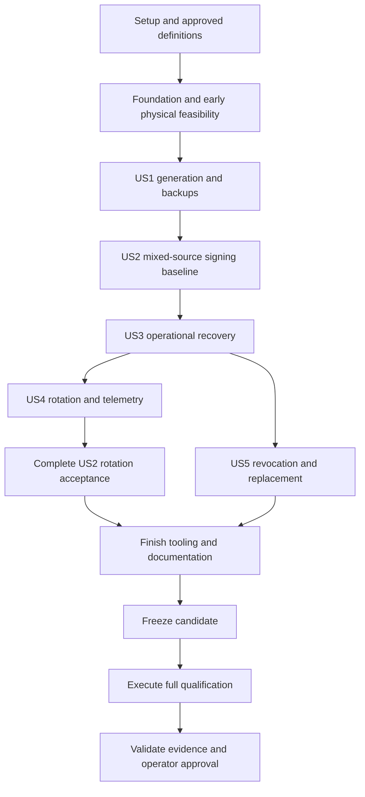

# Tasks: Device-Protected KES Management

**Input**: Design documents in `specs/001-device-kes-management/`: `plan.md`, `spec.md`, `research.md`, `data-model.md`, `quickstart.md`, and all five `contracts/` documents.

**Governance**: `.specify/memory/constitution.md` version 1.1.0. These are unchecked implementation obligations, not evidence of implemented features or passing hardware gates. Preserve all FR-001–FR-032 and SC-001–SC-012 targets.

**Tests**: Included because the specification explicitly requires independent compatibility, regression, security, lifecycle, power-interruption, telemetry, operator and public-network exercises (FR-018–FR-019 and SC-001–SC-012), and adopts executable quality gates. Write behavioral regression/contract cases before their implementations and observe the intended failure; compile failures alone are not behavioral evidence. Tests must exercise consumer-visible behavior, not wiring, source text or incidental wording. Actual device/daemon/CLI/node smokes supplement tests.

**Organization**: Setup, shared foundation, one phase per user story in specification order (US1–US3 P1; US4–US5 P2), then cross-cutting qualification. Each story has its own independently runnable acceptance scenario once its stated prerequisites exist. Shared persistence/crypto primitives are foundational because safe generation and signing cannot ship without them; US3 owns complete operational resumption and fault qualification, not a temporary unsafe persistence path.

## Format: `[ID] [P?] [Story] Description`

- Every implementation task is an unchecked checklist item with a unique sequential ID and exact file path.
- `[P]` identifies tasks that may run together only after the named phase/wave prerequisites have completed, on different files. It does not waive dependencies or permit concurrent edits to shared manifests/module registries.
- `[US1]`–`[US5]` label story tasks only. Setup, foundation and final qualification have no story label.
- An integration owner registers new modules/tests in shared manifests after a parallel wave. Run checks after integrating the wave, not while peers mutate its inputs.

## Path Conventions

- Unprefixed paths are relative to this repository. Most implementation paths are **new planned files**, not existing code. `Cargo.toml` already declares package `cardano-kes-forge`, edition 2024 and binary `kes-forge` at `src/main.rs`; retain that declaration rather than rename the package.
- Short design references such as `contracts/cli-backup.md`, `data-model.md` and `research.md` resolve under `specs/001-device-kes-management/`; implementation paths remain repository-relative unless prefixed with `NODE/` or `CONSENSUS/`.
- `NODE/` expands to `/home/westbam/haskell/cardano-node/`; `CONSENSUS/` expands to `/home/westbam/haskell/ouroboros-consensus/`. These are existing native workspaces, not new directories inside this repository. Preserve their user changes.
- Native path roots below match the supplied checkouts. `NODE/cabal.project` currently selects consensus fork commit `6673fce255f12addb602b0ae2d0a20f51a2cd519`; build the edited consensus workspace through an explicit local project overlay, without resetting the fork or silently building an unchanged remote copy.
- `/home/westbam/haskell/cardano-cli/` is source/oracle input only. No task modifies its source. Separate reproducible oracle builds use CLI 11.4.0.0 commit `25f4d7a6b243d80ed7d716cc91b9c51d9265ace6` and unmodified node 11.1.3 commit `938cba990357ae7c4b7f95c8f75dd9d31174bbeb`, with the distinct API/crypto graphs in `research.md` R1.
- `evidence/<candidate>/<gate>/manifest.json` denotes runtime-generated public evidence, not a fixture to commit. Include revision and dirty-source digest, configuration/approval hashes, tools, environment, scope, case counts and actual verdict. Fixtures, retained corpora and evidence MUST contain no secret material, regardless of repository location. Fixture manifests contain public metadata and references only. Generate disposable secrets at execution time; handle them through transient protected memory or the explicitly authorized credential, recovery and development-inspection outputs required by the tested workflow. Those outputs remain separate from fixture/evidence bundles and follow their workstation-specific custody and cleanup rules; moving or renaming a secret-bearing fixture does not satisfy this boundary.
- Before changing any exported Rust/Haskell symbol, obtain language-server references and migrate all callers, pattern matches, tests and wrappers. Never substitute a fake key/signature, import path, software fallback, CLI fork or compatibility alias.

## Phase 1: Setup (Shared Infrastructure)

**Purpose**: Establish the approved gate definition, pinned workspace, independent baselines and real evidence tooling before product implementation.

- [X] T001 Obtain and record maintainer approval of the foundation/story/final applicability matrix, unchanged sensor thresholds, exclusions, budgets and hardware policy in `specs/001-device-kes-management/contracts/quality-gates.md` and `specs/001-device-kes-management/contracts/security.md`; revalidate changed applicability against the nine full-entry Observatory selections in research R7, retain coverage gaps, and never mark future behavior passed or an implemented scope exempt merely because this is an increment rather than a release.
- [X] T002 Extend `Cargo.toml`, `rust-toolchain.toml`, `crates/kes-core/Cargo.toml`, `crates/kes-protocol/Cargo.toml`, `firmware/Cargo.toml` and `xtask/Cargo.toml` into the planned edition-2024 workspace on Rust 1.99.1; retain `kes-forge`, add `kes-forged` at `src/bin/kes-forged.rs`, include host/shared/xtask default members, exclude target-only firmware from host defaults, and define separate development/release and primary/recovery build surfaces without a firmware allocator.
- [X] T003 [P] After T002, review maintenance, licenses, advisories, provenance and no_std feature suitability of every exact R2/R3/R5 dependency pin, including `kes-summed-ed25519 =0.2.1`, `embassy-rp =0.10.0`, `hpke =0.13.0`, `rand_chacha =0.9.0` and the RustCrypto/Dalek/zeroize set; record decisions in `specs/001-device-kes-management/research.md` and lock accepted direct/transitive sources in `Cargo.lock` without silently substituting algorithms or incompatible releases.
- [X] T004 [P] After T002, create separate locked Haskell oracle projects in `xtask/oracles/cli-11.4/cabal.project` and `xtask/oracles/node-11.1.3/cabal.project`, using GHC 9.6.7/Cabal 3.12.1.0 and research R1's exact index/source pins; build/check explicit unmodified CLI/node executable paths and hashes, reject the installed CLI reporting 11.2.3.1, and preserve the distinct CLI API11.9/crypto2.6 and node API11.6/crypto2.5 dependency graphs.
- [X] T005 Implement actual gate command dispatch, candidate freeze and evidence/acceptance validation in `xtask/src/main.rs`, `xtask/src/evidence.rs` and `xtask/src/acceptance.rs`; bind source/dirty digests, dependencies, tools, gate/approval hashes and scenario/feature inventory, use only fixed approved generated-output exclusions, reject cross-candidate reuse and distinguish pass/fail/inconclusive/unavailable. Add behavioral bundle cases in `xtask/tests/acceptance.rs` for missing/empty/failed/stale/mixed/tampered reports, omitted hardware/features/counts, unauthorized exclusions and absent approvals; an exited-zero subprocess is not proof.
- [X] T006 Implement pinned G1–G6/G12 orchestration before any foundation acceptance in `xtask/src/gates/build.rs`, `xtask/src/gates/tooling.rs`, `xtask/src/gates/behavior.rs`, `xtask/src/gates/properties.rs`, `xtask/src/gates/faults.rs`, `xtask/src/gates/mutation.rs`, `xtask/src/gates/coverage.rs`, `xtask/src/gates/fuzz.rs` and `xtask/src/gates/cognitive_complexity.rs`; invoke real tools with the complete host/firmware/adaptation/fuzz/benchmark feature matrix, approved per-increment scopes and unchanged count/coverage/mutation/fuzz thresholds. Register G8/P1 dispatch and evidence schemas through T005's command/evidence tooling, with explicit missing-runner failures; activation remains blocked until T022 supplies real target-specific physical-cut/load runners and their sensitivity checks pass. Set `clippy.toml` threshold 25, root CLIPPY_CONF_DIR and `-F clippy::cognitive_complexity`; demonstrate compiler/complexity boundary/above-threshold/suppression sensitivity now and require each later target's actual clean/seeded-defect proof before accepting its reading, never pass an absent target.
- [X] T007 Implement `xtask fixture create --network controlled --pools 32 --out-dir ...` in `xtask/src/fixture.rs` as creation of a public scenario manifest; refuse existing output directories and mainnet destructive fixtures. Do not serialize private keys, signing states, passphrases, secret seeds or inputs sufficient to reconstruct them into fixtures. Declare protected runtime-output locations and populate required operational files during execution through the supported workflows, separately from fixture/evidence bundles. Retain only public identities, non-secret references, executable/peer/socket/power-controller paths, network parameters and leader schedules; require separate recovery/provisioning workstations and explicit irreversible authorization rather than silently preparing production hardware.

**Checkpoint**: Approved definitions, reproducible baselines and evidence/fixture tools exist. Each later gate activates only after its own clean/seeded-defect sensitivity is demonstrated; a missing approval or unavailable mandatory tool blocks implementation acceptance.

## Phase 2: Foundational (Blocking Prerequisites)

**Purpose**: Implement shared bounded crypto, identity, wire, storage and hardware primitives, plus reusable physical runners, before broad operator/native integration.

**Critical**: Finish the software Foundation work before story implementation. The recorded Foundation no-go and maintainer's A2 development-order decision permit later implementation without Foundation acceptance. Build physical runners with their measured paths, use A2 only for explicitly labeled exploratory development, and execute every A4-dependent reading on the final frozen candidate.

- [X] T008 Implement checked identity/network types in `crates/kes-core/src/types.rs`: `DeviceId` is "16 random bytes, bound to pinned device Ed25519 identity key and provisioning evidence"; `PoolId` is "BLAKE2b-224 of the registered 32-byte cold verification key; full 28 bytes, not a user label or slot index"; incarnation/generation/request IDs are "independent 16-byte random identifiers"; "A hardware slot 0–31 is only an internal location"; revision/generation/management/credential/certificate/absolute-period fields are "checked unsigned 64-bit integers. Overflow is an explicit failure, never wraparound. Relative period: 0–63"; network binding uses "network magic, SHA-256 of exact enrolled Shelley genesis bytes, `slots_per_kes_period > 0`, `1 <= max_kes_evolutions <= 64`", not the node's differently encoded genesis-hash type.
- [X] T009 [P] After T008, implement canonical framing, operation schemas and the complete stable error taxonomy from `contracts/device-protocol.md` in `crates/kes-protocol/src/frame.rs`, `crates/kes-protocol/src/operations.rs` and `crates/kes-protocol/src/error.rs`, with semantic frame fuzzing in `fuzz/fuzz_targets/frame.rs`; enforce u32be length, <=8192-byte deterministic CBOR maps, depth <=4, exact fields/types and nullable device scope, <=4096-byte exact signing messages, <=1024-byte opcerts, <=2048-byte backups and 2-second incomplete-frame expiry, rejecting oversize before allocation and all duplicate/unknown/noncanonical/trailing data without parser fallback.
- [X] T010 [P] After T008 and T004, implement independent byte/file oracle drivers in `xtask/oracles/cli-11.4/app/Main.hs`, `xtask/oracles/node-11.1.3/app/Main.hs` and `xtask/src/oracles.rs`; expose generation, VK derivation, all-period evolution/signature verification and OCertSignable/file validation through versioned bytes, use runtime-generated disposable inputs, and prove disagreement detection with a corrupted signature rather than treating Rust as its own oracle.
- [X] T011 Adapt attributed upstream 0.2.1 in `third-party/kes-summed-ed25519/Cargo.toml` and `third-party/kes-summed-ed25519/src/lib.rs` for no_std, fixed zeroizing buffers, one-leaf cooperative generation and public-tree acceleration; retain source checksum/license/reviewable patch history, remove hot-path allocations and secret-debug formatting, and preserve Sum6KES rather than CompactSum6KES or custom primitives.
- [X] T012 Implement the reviewed Sum6KES adapter in `crates/kes-core/src/crypto.rs` and behavioral differential cases in `crates/kes-core/tests/crypto_interop.rs`; enforce "Fixed 32-byte verification keys; 448-byte Sum6KES signatures; 608-byte canonical signing state" and "Algorithm/version identifiers are explicit at persistence/file boundaries", compare both Haskell baselines over all 64 periods including 31→32/final/invalid/network L<64, and exclude Rust period metadata from conventional key serialization.
- [X] T013 Implement shared Device, PoolRegistration, KESGeneration and PublicObject state in `crates/kes-core/src/state.rs`; preserve every data-model field, including mode/health, management roots/history, credential epoch/revocation, recipient identity, generation/creation IDs, erased marker, public/backup digests and optional certificate; enforce "At most 32 live registrations", "At most one active/current-expired plus one staged generation", "Staged generation cannot overwrite another", and public object's "4064-byte public tree" with version/length/digest and "Contains no plaintext secret. Immutable while referenced"; enforce "Authenticate through the secret snapshot" and "OTP roots and derived storage/identity/session keys are secret; production operations require verified release readiness, not merely `mode=release`." Create `crates/kes-core/tests/lifecycle_properties.rs` here and extend it with every implemented transition through T020; before foundation acceptance run >=10000 accepted sequences of 1–256 operations across 32 pools with no claims for unimplemented future behavior.
- [X] T014 Implement certificate decoding/validation and lifetime arithmetic in `crates/kes-core/src/certificate.rs` and semantic parser/invariant fuzzing in `fuzz/fuzz_targets/certificate.rs`; preserve canonical bytes/cold VK/KES VK/counter/start/digest and enforce "Verify cold signature over the release's OCertSignable bytes, cold identity, VK and counter", "Network is NOT a signed opcert field; network binding is separately enforced by enrollment/session/request", and "Counter is strictly greater than the last activated counter for a new generation; exact duplicate certification is idempotent"; require `S <= P < S+L` with checked addition and separate enrolled network binding, rejecting different recertification without damaging the active key.
- [X] T015 Add failing transactional behavior cases in `crates/kes-core/tests/journal_faults.rs` for candidate-write/COMMIT/erase/CLEAN cuts, authentication failure, parent-revision disagreement, missing immutable objects and damaged committed successors; assert no acknowledged rollback, old-secret use or silent blank initialization and exercise the flash tear model rather than mock call counts.
- [X] T016 Implement authenticated versioned double-bank snapshots, public-object references and COMMIT/CLEAN recovery primitives in `crates/kes-core/src/journal.rs` and semantic authenticated-snapshot fuzzing in `fuzz/fuzz_targets/snapshot.rs`; read-verify objects/candidate, commit successor, erase/read-verify predecessor, wipe RAM/cache, then write/read-verify CLEAN before ACK/signature; handle every reachable marker combination and interrupted CLEAN under qualified flash rules, quarantine ambiguous/corrupt authoritative state instead of falling back, and use fresh AEAD nonces with explicit entropy failure.
- [ ] T017 Implement fitted-flash storage and RAM-resident critical operations in `firmware/src/storage.rs` and `firmware/memory.x`; coordinate both cores/XIP/cache, isolate 32×32-KiB pool regions, two 4-KiB secret banks with <=3584-byte snapshots plus separate 256-byte COMMIT/CLEAN pages, two 8-KiB public objects and directory/firmware partitions within the 3152-KiB reservation; measure actual flash size/endurance and forbid undeclared wear-leveling copies or cross-pool spill.

  Hardware continuation: RP2350 raw OTP `FLASH_DEVINFO` and its enable flag both read zero; the ROM's `0x0c00` is the 16-MiB default, not a measured 4-MiB chip. Firmware now reads JEDEC and SFDP from CS0 in a guarded RAM-resident transaction. The A2 passed the approved JEDEC/SFDP/density check and completed real directory and pool-journal writes. The public identifiers do not prove package marking or endurance; physical qualification, independent RAM/XIP review and the A4-or-later campaign remain outstanding, so T017 stays unchecked.
- [X] T018 Implement the secure/nonsecure runtime boundary and health-checked entropy in `firmware/src/main.rs`, `firmware/src/security/gateway.rs` and `firmware/src/entropy.rs`; secure code owns state/flash/crypto/TRNG/OTP, nonsecure USB passes a validated bounded copy with no secret pointer, derive domain-separated keys, seed ChaCha20Rng from 256 credited TRNG bits and reseed before each generation/session, fail boundedly on health errors with no time/USB/pseudorandom fallback, and keep development execution explicitly disposable/unlocked.
- [X] T019 Implement challenge-bound INFO/OPEN and request/response authentication in `crates/kes-core/src/session.rs` and authentication-state fuzzing in `fuzz/fuzz_targets/session.rs`; bind pinned device/boot/scope/incarnation/epoch/open-counter/request transcript, use the contract's HPKE suite and exporter labels with Ed25519 authorization and HMAC-SHA256 envelopes, independent monotonic u64 sequence spaces, one session per scope, 32 pool plus one management transport session, and wipe/invalidate on disconnect/reboot/revocation/overflow; management transport alone must not authorize mutation.
- [X] T020 Implement bounded USB dispatch and low-level certify/activate/sign/evolve execution in `firmware/src/usb.rs`, `firmware/src/scheduler.rs`, `crates/kes-core/src/activation.rs` and `crates/kes-core/src/signing.rs`; implement first-generation certified-staged→active with eligible-period evolution and durable cleanup before US1/US2, extending foundational lifecycle properties. Device dispatch is single-flight: one 8192-byte nonsecure receive, one secure request and one response buffer, parse exact message bytes in place, no per-pool body copies; service queues belong to the host. Enforce research R4's fixed session/hot-metadata/shared-workspace/stack ceilings, one global cooperative generation job with one leaf per turn, remaining original `min(slot budget, operation ceiling)` without reset (SIGN<=500 ms, INFO/Open/STATUS/OP_STATUS<=2 s, GENERATE<=10 min); deadline expiry returns the stable status and never commits partial output. Record public operation/latency/RAM readings and artifact identity under `target/foundation-smoke-b25qhsxz/`.
- [X] T021 Implement reproducible core microbenchmarks in `crates/kes-core/benches/kes.rs` and `xtask/src/gates/performance.rs`; measure generation, every evolution boundary, 0/256/4096-byte sign/verify, codecs and journal transforms with Criterion 0.8.2 (100 samples, 5-second warmup, 10-second measurement), peak buffers/allocations and controlled-delay sensitivity; establish a first correct baseline rather than benchmarking the skeleton, then enforce P0's three-run 95%-CI/1.05 and environmental-noise rules.
- [ ] T022 Implement the reusable real-board feasibility campaign in `xtask/src/qualify/feasibility.rs` using public scenario manifests and runtime-generated disposable secrets: emulate the contracted bounded host queue and single-flight device dispatch, populate 32 active+32 staged core states, admit 32 simultaneous maximum-4096-byte requests and measure original admission/dispatch/verified-completion times across aligned/midpoint evolution, erases, activation/signing/USB and independent verification. Own the first usable load runner in `xtask/src/qualify/load.rs` and software-cut/physical power-controller runner in `xtask/src/qualify/power_loss.rs`; enumerate every implemented foundational transaction boundary, retain public before/after ACK state and recovery duration, independently verify returned signatures, and exclude deliberate corruption from successful recovery counts. Exercise background-generation peak memory and assert every research R4 ceiling. Run host/software controls now. A separately authorized A2 development flash may produce exploratory functional/timing evidence with disposable keys; it never satisfies the hardware gate. Defer required stock-clock A4-or-later RAM/link/flash/erase, physical G8 and P1 execution to T107–T109 without lowering the 500-ms/capacity targets.

  Software continuation (2026-10-26): the manually executed protected power-loss report passed 99330 ordinary cases; `qualify load-software` now exercises 160 real core requests with both pinned native verifiers, 32 journal recoveries and 64 background generation leaves. Host-only evidence does not complete the physical adapter/controller, memory high-water or board campaign obligations; T022 intentionally remains unchecked. See research's T022 host-control continuation and quickstart's protected invocation.

- [X] T023 Extend and execute gate sensitivity in `xtask/src/gates/sensitivity.rs` for implemented core/protocol paths: inverted cross-pool authorization, accepted stale period, corrupted signature, lost acknowledged commit, skipped erase, parser/authentication bypass, unexecuted coverage path and controlled timing regression must be detected, with public counterexamples and clean results. Run the T006 real orchestration over foundational property/frame/certificate/snapshot/session targets before accepting them; artifact/output/native probes become mandatory when those paths are introduced, never silently exempt.
- [X] T024 Finalize foundational decisions, procedures, applicability and pending obligations in `specs/001-device-kes-management/research.md`; freeze and execute the first Foundation candidate; write only its measured verdict and references to `evidence/<candidate>/foundation/manifest.json`; never reclassify failed, inconclusive or unavailable readings. Candidate `83492132e0b12d0749381f13a5d24ffa7c98877b37c09418dfc59f7ae23ea6df` recorded a no-go with G7/G12 passing, G1/G8 inconclusive and G2/G3/G4/G5/G6/G9/P0/P1 unavailable. The maintainer then explicitly authorized continued software/A2 exploratory development and deferred every A4-dependent check to final T107–T109. This completes the decision/evidence task, not Foundation acceptance; software failures remain actionable and any later freeze creates a new identity.

**Checkpoint**: Shared primitives exist and the first Foundation no-go is recorded. The explicit development-order decision allows story implementation, but Foundation/story acceptance and all A4-dependent readings remain pending until the final frozen candidate.

## Phase 3: User Story 1 — Generate Pool Keys and Compatible Backups (Priority: P1)

**Goal**: Provision/enroll two pools, generate keys only on the Pico, export stable public keys and immutable encrypted backups, and recover conventional keys only on the separate backup workstation. Include the specified recipient lifecycle and development/release boundary.

**Independent Test**: On two registered pools run the actual `kes-forge key-gen-KES`, retry lost responses and retrieve identical artifacts across restart/evolution; separately recover each key and use unmodified CLI 11.4.0.0 to derive matching VKs and issue matching certificates. Exercise wrong password/key/artifact/identity/output and interrupted password publication. Verify explicit disposable development inspection and production refusal of development/unprovisioned evidence; release claims require actual locked-board negative evidence. No patched node is required for this milestone; accepted conventional-backup blocks are additionally qualified under US2/final G7.

### Tests for User Story 1

- [X] T025 [P] [US1] Add CLI generation/backup contract cases in `tests/generation_contract.rs` for exact device-only flags, no era/node prefix/old alias/`--signing-key-file`/software fallback, durable request reconciliation, same-byte fetch, recipient/pool mismatch and multi-output collision/crash recovery; assert committed identity and decoded Cardano files rather than help wording.
- [X] T026 [P] [US1] Add recipient/recovery filesystem cases in `tests/recovery_files.rs` for authenticated bindings, wrong password/recipient, altered ciphertext/signature, hostile KDF parameters, symlinks/existing outputs, protected-memory failure and interrupted rewrap/publication; require no partial named plaintext, input mutation, overwritten key or secret diagnostics.
- [X] T027 [P] [US1] Add generation/backup model cases in `crates/kes-core/tests/generation.rs` for entropy failure, incomplete job publication, stable request/generation IDs, immutable artifacts after evolution/reboot, full staged slots, recipient/credential epoch cancellation and merge with a newer active revision.
- [X] T028 [P] [US1] Add security-mode/provisioning and clean-bootstrap contract cases in `tests/security_modes.rs` for exact v1 credential/authority/config/manifest schemas, standard key encodings, creation/custody and owner-only permissions, mismatched public/private/scope/identity inputs, unsafe paths, enrollment before daemon setup, and authorized UID mappings; preserve fresh challenge/pin verification, dev/unprovisioned rejection, irreversible-consent refusal, no release→development transition and separate management/firmware/pool/recipient authority. Missing prerequisites fail explicitly; software cases are not hardware qualification.

### Implementation for User Story 1

- [X] T029 [US1] Implement RecipientKeyFile creation and protected passphrase input in `src/backup/recipient.rs`; preserve format/KDF/public-ID/salt/nonce/encrypted-private-key/tag fields and the constraints "Backup workstation only. Keypair remains unchanged on password change. Password and unlocked key are transient secret memory"; enforce "Pico/primary stores only public enrollment data and encrypted artifact"; use OS CSPRNG, KESRCP01, exact Argon2id v19 65536-KiB/t3/p4 parameters, 16-byte salt, 24-byte XChaCha nonce, full-header AAD and public identity verification, with echo-disabled confirmed non-empty UTF-8 terminal input only and no noninteractive/env/argv fallback.
- [X] T030 [US1] Implement canonical KESBKP01 device-signed HPKE artifacts in `crates/kes-core/src/backup.rs`, strict public decoding in `crates/kes-protocol/src/backup.rs` and semantic artifact fuzzing in `fuzz/fuzz_targets/artifact.rs` before US1 acceptance; preserve device/pool/incarnation/generation/VK/recipient binding and exact domains/suite/lengths from `contracts/cli-backup.md`, enforcing "Created once from period-zero state; identical bytes retained across evolution/reboot/recipient changes" and "Retrieval only for staged, active or current expired generation. Archive before replacement reclaims it"; encrypt exactly 608 bytes and verify signature independently of HPKE base encryption. Extend lifecycle properties with generation/publication and activate artifact authentication/output probes rather than leaving G3/G6 until the final phase.
- [X] T031 [US1] Implement generation/public-object publication and GENERATE/OP_STATUS/GET_BACKUP in `crates/kes-core/src/generation.rs`; enforce "Generation completion merges into latest pool revision, not the active-state snapshot at job start" and "Write and read-verify before publishing the generation", capture/recheck incarnation/recipient/credential policy epochs, cancel and wipe on policy change, preserve creation ID/digest/generation number, distinguish IN_PROGRESS/NOT_COMMITTED/UNKNOWN/RESULT_RECLAIMED, and never regenerate a reclaimed result or retain extra initial plaintext for later export.

  Persistence continuation (2026-10-26): authenticated generation checkpoints, explicit post-recovery retry, stale-handle rejection and bounded firmware object publication now have protected real-journal/NOR fault coverage. Product USB dispatch remains part of T045/T047.
- [X] T032 [US1] Implement management envelope validation, enrollment and history storage in `crates/kes-core/src/management.rs` and `crates/kes-core/src/directory.rs`; preserve device/scope/incarnation/action/sequence/request/expected-revision/payload-digest/offline-signature fields and "Canonical domain-separated encoding; replay sequence survives reboot. Exact last duplicate returns recorded outcome; lower sequence or changed payload fails"; atomically bind cold/network/recipient/machine public keys and fresh incarnation, reject a 33rd live registration, and enforce "Management signs enrollment and changes; normal pool authority cannot change recipient/credential/network or delete registration" and "Firmware-signing authority is distinct from this management authority and pool cold authority." Implement authority-specific credential/key creation and strict encodings from cli-backup.md in `src/host/credentials.rs` and `src/cli/credentials.rs`, keeping offline/recipient private keys off the primary and publishing keys/config inputs only with the contract's protected-file rules.
- [X] T033 [US1] Implement the actual single-USB-owner Unix service in `src/bin/kes-forged.rs`, `src/host/daemon.rs` and `src/host/socket.rs`; enforce SO_PEERCRED, protected socket paths, exact UID→connection authorization, daemon-owned restricted credentials and independent pool sessions. Support zero-pool management startup before enrollment and explicit static mapping restart. Own 32 signing +32 lifecycle +32 status +one management frame slots of <=8192 bytes, counting in-flight requests; cap peers at 64 with one <=8192-byte partial frame/peer and 2-second expiry. Admit before queueing, round-robin single-flight USB dispatch with remaining original deadlines, discard expired queued/late results, and never reuse a busy secure workspace after uncertain timeout. No TCP listener, recovery credentials or DEV_INSPECT on node sockets.
- [X] T034 [US1] Implement exact v1 DaemonConfig, DeviceConfig, DeviceIdentity and PoolConnection parsing/creation plus authenticated operations in `src/host/config.rs` and `src/host/client.rs`, preserving every cli-backup.md field, encoding, limit and filesystem rule; retain "Host configuration, never a decryption credential. OS ACL plus per-pool device authentication" and "Multiple processes may use configured pool connections; daemon serializes each pool's signing/lifecycle work". Resolve relative paths against configuration location, reject cross-file identity/credential/UID conflicts, validate INFO/OPEN and committed response identities. Implement durable public request records once in `src/host/operations.rs`: persist identity/payload digest before dispatch, reject changed-payload reuse, reconcile unknown mutations through status, preserve generation number/creation ID and RESULT_RECLAIMED, and recover process restart without device rollback.
- [X] T035 [US1] Implement crash-recoverable public VK/artifact/manifest publication in `src/host/publication.rs`; validate device signature/commitment/bindings before publishing, fsync each output and final completion manifest, accept a preexisting partial result only when its validated bytes belong to the same operation, reject unrelated existing files, and resume the same committed generation rather than claiming an all-files atomic transaction.
- [X] T036 [US1] Implement `kes-forge key-gen-KES` and `backup fetch` in `src/cli/generation.rs` and `src/cli/backup.rs` with every required flag from `contracts/cli-backup.md`, direct daemon calls, stable request/generation identity, conventional `KesVerificationKey_ed25519_kes_2^6`/`5820` envelope, encrypted-export descriptions and no host generation/CLI subprocess/old command alias; report success only after all public outputs are durable.
- [X] T037 [US1] Implement authorized-workstation recovery in `src/backup/recover.rs` and `src/backup/publication.rs`; verify trusted-device signature, expected device/pool/generation, recipient/AEAD and derived VK before a conventional `KesSigningKey_ed25519_kes_2^6`/`590260` file, require locked non-dumpable zeroizing memory and owner-only safe parents, publish a complete 0600 inode via O_TMPFILE/fsync/linkat-no-replace/directory-fsync, fail without unsafe fallback when unsupported, and report post-link durability uncertainty without overwriting on retry.
- [X] T038 [US1] Implement `recipient change-password` in `src/backup/password.rs`; unlock with the old password, confirm a non-empty replacement, keep the same keypair/recipient ID, use fresh salt/nonce, verify the encrypted replacement in memory, fsync and atomically replace only encrypted staging files, and preserve a usable old/new protected file under interruption without changing artifacts or device enrollment.
- [X] T039 [US1] Implement management-authorized recipient replacement in `crates/kes-core/src/recipient.rs`; update only future-generation recipient policy, cancel unpublished jobs captured under the old policy, retain existing artifact bytes/recipient IDs and replay history, reject pool-only redirection, and require archival of old protected recipient keys rather than a password-reset/revocation claim.
- [ ] T040 [US1] Implement attended `provision inspect/prepare/apply` in `src/cli/provision.rs` and `src/host/provisioning.rs` against the exact security-contract ProvisioningManifest and cli-backup DeviceIdentity/authority schemas; pin picotool 2.3.1/manual/policy hashes, inspect exact A4-or-later silicon/ROM/flash/vendor OTP fields, validate every manifest trust/identity/image/action binding and custody handoff, require `--authorize-irreversible` only for apply, eliminate development keys/exposed roots and refuse boards unable to establish fresh trust. Order image/key setup before locks and sign records only after trusted readback/required negatives; interruption remains release-unprovisioned.

  Provisioning continuation (2026-10-26): bounded read-only vendor inspection and trusted-input validation are implemented; `provision apply` explicitly refuses before touching hardware because device-root generation, authenticated protection readback and qualified negative checks are not implemented. Approved ceremony policy/recipe/image/trust inputs are also absent. A4 qualification remains deferred; T040 stays unchecked.
- [ ] T041 [US1] Implement release enforcement in `firmware/src/security/policy.rs`, `firmware/src/security/boot.rs` and `firmware/src/security/isolation.rs`: verify signed secp256k1/SHA-256 boot trust and key-slot policy, monotonic firmware rollback, secure/nonsecure debug closure, alternate USB/UART/RAM/BOOTSEL restrictions, OTP locks/root clearing, SAU/MPU/gateway/stack guards, ACCESSCTRL/DMA/XIP/QMI/core isolation, qualified TRNG, OTP glitch/BOD and RCP fail-stop checks with E3 random delays disabled; enforce every applicable security-contract row and refuse generation/signing on incomplete evidence.
- [X] T042 [US1] Implement host readiness verification in `src/host/security.rs`; validate exact DeviceIdentity/ProvisioningManifest/ProvisioningRecord and authority encodings, trusted reviewer signature/public handoff, every referenced trust-key/content digest, ceremony step result and allowed policy/image/security version. Match pinned online device identity, silicon/ROM/flash and fresh challenge/boot nonce; distinguish development/release-unprovisioned/release-ready, refuse replay/mismatch/self-declared readiness and make isolated-development opt-in explicit without overriding hardware locks.

  Verified (2026-10-26): live INFO/OPEN now validates independently signed, challenge- and boot-bound online evidence against the signed ceremony and its pinned management, transport and reviewer authorities. Protected integration tests exercised a valid release session and rejected replay, mismatched fields, malformed evidence, untrusted references and altered/missing ceremony files. This software fixture is not a release-firmware or A4 security qualification.
- [X] T043 [US1] Implement DevelopmentInspection and protected `KESDEV01` output in `firmware/src/development/inspection.rs` and `src/cli/development.rs`; bind device/pool/incarnation/generation/relative period/current raw state and enforce "Development-only protected file on trusted development workstation; absent from release image and normal node signing interface. Not an initial backup or an import format"; use T037's publication protections, inspect only disposable current state, and exclude handlers/secret formatting from release at compile/link time.

  Verified (2026-10-27): the separate development CLI extracted the disposable A2's authenticated active period-1 state into a no-overwrite `0600` KESDEV01 file under a fresh no-swap, non-dumpable cgroup. Independent protected verification matched the active public key and validated a signature; missing opt-in and output collision were refused. Codec tests reject DEV_INSPECT on node sockets and the release firmware configuration compiles without the feature-gated handler. The disposable output link was removed; no erasure of external copies is claimed.
- [ ] T044 [US1] Implement management-authorized signed inactive-slot firmware update in `firmware/src/update.rs` and `src/cli/firmware.rs`; bind image/schema/partition/security-version digests, check firmware authority separately, enforce sequential bounded offsets without raw-address APIs, keep an admissible verified image through upload/trial/copy/OTP finalization, retain v1 storage schema, resume authenticated intent after power loss, reject dev/unsigned/unauthorized/downgrade images and rollback exhaustion, and demonstrate interrupted-update recoverability rather than adopting a replacement-on-finalization exception.

  Firmware-update continuation (2026-10-27): a bounded inactive-slot upload state machine now requires independent trust and authenticated storage backends, verifies sequential page-safe writes and image readback, restarts interrupted writes safely, and refuses unauthorized/development/downgrade inputs in six software regressions. Verified means inactive candidate only, not installation. The product runtime, approved signature transcript/encoding, qualified slot/journal adapter, trial/copy recovery and OTP rollback finalization remain unavailable; T044 stays unchecked.
- [X] T045 [US1] Wire US1 generation, `credential create`, `authority key-create`, `management enrollment-create`, management prepare/sign/apply and provisioning commands from cli-backup.md into `src/main.rs`, `src/lib.rs`, `src/cli/mod.rs`, `src/cli/management.rs` and `src/host/management.rs`; expose T020 initial certify/activate in `src/cli/rotation.rs`. Implement baseline ConfirmedObservation/NodePeriodObservation and bounded OperationLatency in `src/host/observation.rs`, `src/host/latency.rs` and `src/cli/status.rs` now, not after generation acceptance: matching context, fixed 30000-ms monotonic expiry, immediate invalidation, no-node observation unavailable, eight RAM-only last-completed operation samples/pool, exact success/error/IN_PROGRESS and JSON fields, original admission-to-validation latency and no status-read refresh. Preserve nullable fields/exit codes 0/2/3/4/5/6/7, no secret logs/device telemetry storage, and exercise absent/fresh/stale/timeout cases in `tests/operator_status.rs`.

  Host continuation (2026-10-26): enrollment-create/prepare/offline-sign/apply are registered and a real CLI/socket/daemon smoke passed against RAM-only core enrollment, including uncertain post-commit and duplicate reconciliation, signature tamper and primary signing refusal. Public status and credential-free primary clients are now implemented; an actual A2 USB/daemon/CLI status smoke passed without an operator private credential. Complete provisioning and durable product-firmware management service remain outstanding; T045 stays unchecked.

  Device continuation (2026-10-27): the disposable A2 has a one-time health-checked persistent identity and explicitly provisioned authenticated directory. Three separately signed ENROLL operations committed distinct pool journals over authenticated USB; management STATUS and exact enrollment retry survived reboot. Independently authenticated pool sessions and interleaved OP_STATUS requests passed. A recovery-capable disposable pool generated a staged KES key cooperatively, retained the exact encrypted backup across repeated fetches and reboot, and host recovery authenticated and decrypted the 608-byte key against the generated verification key. It then certified and activated that key, evolved to period 1 and produced an independently verified signature; signing and recovery passed again after reboot, while an altered message failed verification. Integrated NOR/protocol regressions cover authorization, tamper and torn writes. The full real-daemon two-pool CLI workflow and production provisioning remain outstanding; T045 and T047 stay unchecked.
- [X] T046 [US1] Implement distinct primary/recovery/management/provisioning/development installation profiles in `xtask/src/package.rs`; primary installs kes-forged and safe operator commands, recovery owns local recipient/private recovery, management owns offline authorization/key creation, and provisioning owns attended ceremony tools; development inspection is separately built. Enforce exact command/profile custody restrictions from cli-backup.md, legitimate USB IDs, no implicit flashing/OTP and no recovery/offline-management private secrets on the primary.

  Packaging continuation (2026-10-27): real exact-feature release builds staged management, recovery and development packages, checked executable identities/complete role inventory/forbidden-command refusal and published public hash manifests without keys/configuration/USB rules. The development package includes `dev inspect`. Missing firmware-update and attended-apply handlers still block full primary and provisioning package publication; T046 stays unchecked.
- [ ] T047 [US1] Implement and run a clean-install bootstrap and two-pool real-daemon/socket/CLI smoke in `xtask/src/qualify/generation.rs`: create every required key/public/config/manifest input through documented workstation commands, start the daemon, prepare/sign/apply development enrollment and generate both pools. Exercise missing/malformed/cross-scope inputs, restricted permissions, custody, original request timing/error status, durable lost-response retry, identical fetch, staged-capacity/entropy failure and partial publication; compare conventional generation using unmodified CLI and retain public evidence only. Extend T022's `power_loss.rs` and `load.rs` for generation/artifact/publication and actual daemon load. Run software controls and an authorized A2 disposable-development smoke; keep A4 physical G8/P1 execution for T107–T109.

  Device continuation (2026-10-27): a real daemon with two isolated-development pool routes queried both physical A2 pools. The actual operator CLI started and reconciled generations for both routes, including a successor at pool revision 5, published both verification keys and encrypted backups, refetched one backup byte-for-byte, and certified the successor using a disposable cold key. This used explicit test credentials and non-release fixture metadata, not the required clean-install ceremony or full T047 failure/load campaign; T047 remains unchecked.

  Later A2 continuation (2026-10-27): real CLI generation returned structured IN_PROGRESS and committed JSON on exact retry for two pools. A node-style SIGN through the real daemon returned a 448-byte signature verified against the active public key and rejected an altered message. Recipient replacement preserved the archived old backup; staged discard followed by a new device generation produced an artifact recoverable with the new recipient. Clean-install and load coverage remain outstanding.
- [X] T048 [US1] Implement `xtask/src/qualify/security_modes.rs` and its public evidence schema. Exercise development-mode correctness, release-unprovisioned refusal and host-policy negatives in software and on an authorized disposable A2 development image. Do not attempt or claim A2 secure-boot/debug/DMA/OTP/update/rollback qualification. T109 executes the complete extraction/debug/boot/DMA/update/downgrade, interrupted provisioning, fresh-trust transition and post-lockdown service matrix on qualified A4-or-later hardware.
- [ ] T049 [US1] Implement and run `qualify recovery-files` in `xtask/src/qualify/recovery_files.rs` against a separate recovery workstation; exercise full recipient create/recover/rewrap/recover/recipient-replacement lifecycle and every wrong-password/key/artifact/output case, inspect permissions and captured output, inject interruptions and prove usable protected-key retention, then activate artifact/output sensitivity probes in `xtask/src/gates/sensitivity.rs`.

  Local continuation (2026-10-27): the real recovery-profile CLI campaign passed 30 disposable cases against an A2-generated backup, including create/recover/rewrap/recover, old-key archive recovery, wrong inputs and permissions, and SIGKILL at terminal-entry barriers. Its public report explicitly records no separate-workstation proof, no physical interruption and no in-campaign recipient-replacement result. A new G4 artifact-authentication sensitivity lane passed clean recovery/no-clobber checks and detected actual plaintext publication after signature verification was omitted in a separate disposable source copy. Independent publication-only fault injection, frozen-candidate execution and the full separate-workstation lifecycle remain outstanding. Disposable plaintext output links were removed after the run.
- [ ] T050 [US1] Update `specs/001-device-kes-management/quickstart.md` with exercised clean-install key/config/provisioning/enrollment/daemon/generation/certificate/backup/inspection commands, exact prerequisites and public/private workstation handoffs; include status freshness/latency examples, long unique passphrases, protected old recipient archives, archive-before-reclaim, copied-key/password limitations, irreversible loss and fresh-generation compromise response. No undocumented JSON fabrication or use of the disposable xtask fixture in the production bootstrap procedure.
- [X] T051 [US1] Implement and run `xtask/src/qualify/interop.rs` through both unmodified native oracles for device-generated VKs, recovered 608-byte keys, certificate issuance/signature validation, all 64 evolution periods and unchanged artifact/VK identity; verify wrong certificate/network/key/message rejection and explicit CLI 11.4.0.0 provenance without modifying its source.

  Offline continuation (2026-10-27): the protected runner authenticated an A2-generated backup and its actual cold-signed certificate, recovered key and scope; both pinned native baselines cross-verified signatures and negative inputs across all 64 period states, and validated certificate issuance/signatures. The public report records device/network certification and unmodified CLI executable issuance as not exercised. This local development evidence does not complete T051.
- [ ] T052 [US1] Execute every available US1 software matrix gate through existing runners, including >=10000 expanded lifecycle sequences, all five nonempty fuzz targets for >=1 hour each, mutation/coverage/sensitivity, CLI help/public workflow smokes and A2 disposable functional scenarios when authorized. Record actual candidate-bound readings, failures and deferred A4/later-node obligations in `evidence/<candidate>/US1/manifest.json`. This is a development milestone, not accepted US1 evidence; physical G8/P1/G9 remain `E` and execute on the final frozen candidate.

  Local continuation (2026-10-27): the protected `lifecycle_properties` suite passed all nine tests, including its fixed 10000 accepted-sequence campaign across the expanded lifecycle model. Five isolated AddressSanitizer fuzz runs each completed 3601 seconds with zero semantic violations: frame 9990735 executions, artifact 761152736, certificate 390660965, snapshot 766300 and session 3742001. The artifact target now emits actual semantic counts and has a valid public seed. These are unfrozen software readings; full mutation, coverage, candidate-bound reporting and physical obligations remain outstanding.

**Checkpoint**: A complete generation/backup/security-mode increment is usable independently of patched-node development. It is not yet an end-to-end production forging release.

## Phase 4: User Story 2 — Select Device Signing for Multiple Pools (Priority: P1)

**Goal**: Add native device signing per credential, preserving file and single-pool agent sources; one mixed bulk node continues file-backed forging while the device is unavailable.

**Independent Test**: Start one actual node from a single bulk file containing distinct file/device pools; independently accept at least ten blocks per pool, disconnect during signing, require zero device-outage-induced file-pool misses, reconnect to an accepted device block with unchanged PID. Separately run legacy bulk, all three singleton sources and non-overlapping recovered-key backup with the Pico disconnected. Reject malformed/duplicate/conflicting and bulk-agent entries. US4 later reruns this same fixture through hot rotation; that cross-story portion is not falsely claimed at this checkpoint.

### Tests for User Story 2

- [X] T053 [P] [US2] Add native source/bulk behavioral cases in `NODE/cardano-node/test/Test/Cardano/Node/KesForgeCredentials.hs` for unchanged embedded-envelope triples, interleaved v1 file/forge objects, singleton exclusivity, duplicate JSON keys, entry-local paths/network/certificate binding, conflicting duplicate pools and unsupported bulk kes-agent; assert entry-indexed secret-free errors and permit static-valid startup with no daemon/device.
- [X] T054 [P] [US2] Add native external-signing behavioral cases in `CONSENSUS/ouroboros-consensus-protocol/test/Test/Consensus/Protocol/KesForge.hs` for exact header bytes, wrong message/key/period/generation/certificate, expired deadlines, disconnect at the actual forge boundary and typed failure without block submission; cover unchanged file/agent semantics and migrate the real native test-component registration during integration.
- [X] T055 [P] [US2] Add actual daemon/socket authorization, contention and deadline cases in `tests/daemon_signing.rs` for multiple processes/connections, wrong UID/pool, one flooding pool, unavailable USB, late response discard, independent file-backed work and reconnect state reconciliation; use real socket consumers and bounded fixtures rather than mock forwarding assertions.

### Implementation for User Story 2

- [X] T056 [US2] Add `--shelley-kes-forge-config` and per-credential source configuration in `NODE/cardano-node/src/Cardano/Node/Types.hs`, `NODE/cardano-node/src/Cardano/Node/Parsers.hs` and `NODE/cardano-node/src/Cardano/Node/Configuration/POM.hs`; preserve existing file/agent flags, enforce exactly one singleton source, migrate all ProtocolFilepaths constructors/consumers found by references and update native help without a process-global source switch.
- [X] T057 [US2] Implement duplicate-key-aware legacy/v1 mixed bulk decoding in `NODE/cardano-node/src/Cardano/Node/Protocol/Shelley.hs`; retain exact `[operationalCertificate, vrfSigningKey, kesSigningKey]` embedded-envelope order, enforce the node-contract object/source fields with no malformed-entry defaults, validate all entries before workers, resolve connection-relative paths and report `FILE[index].field`, while leaving file entries uncapped by device slots and independent of runtime device availability.
- [X] T058 [US2] Implement the bounded native Unix/CBOR client in `CONSENSUS/ouroboros-consensus-protocol/src/ouroboros-consensus-protocol/Ouroboros/Consensus/Protocol/KesForge/Client.hs`; follow the local-service contract without per-signature shelling out, preserve connection identity and original monotonic/slot budget, validate response context and security policy, and expose typed unavailable/auth/replay/stale/deadline errors rather than fake key delivery.
- [X] T059 [US2] Add `PraosCredentialsExternal` and secret-free external HotKey state in `CONSENSUS/ouroboros-consensus-protocol/src/ouroboros-consensus-protocol/Ouroboros/Consensus/Protocol/Praos/Common.hs` and `CONSENSUS/ouroboros-consensus-protocol/src/ouroboros-consensus-protocol/Ouroboros/Consensus/Protocol/Ledger/HotKey.hs`; represent unavailable/confirmed evolution and introduce recoverable typed signing failures, preserving file/agent behavior and migrating every referenced constructor/pattern match.
- [X] T060 [US2] Thread typed failures and exact native Signable serialization through `CONSENSUS/ouroboros-consensus-cardano/src/shelley/Ouroboros/Consensus/Shelley/Ledger/Forge.hs`, `CONSENSUS/ouroboros-consensus-cardano/src/shelley/Ouroboros/Consensus/Shelley/Protocol/Praos.hs`, `CONSENSUS/ouroboros-consensus-cardano/src/shelley/Ouroboros/Consensus/Shelley/Protocol/TPraos.hs`, the corresponding protocol `Praos.hs`/`TPraos.hs` under `CONSENSUS/ouroboros-consensus-protocol/src/ouroboros-consensus-protocol/Ouroboros/Consensus/Protocol/`, `CONSENSUS/ouroboros-consensus/src/ouroboros-consensus/Ouroboros/Consensus/Block/Forging.hs` and `CONSENSUS/ouroboros-consensus/src/ouroboros-consensus/Ouroboros/Consensus/HardFork/Combinator/Forging.hs`; migrate all additional references/test helpers, with no pure-I/O shim or fabricated secret/signature.
- [X] T061 [US2] Handle recoverable failure around the actual `Block.forgeBlock` call in `CONSENSUS/ouroboros-consensus-diffusion/src/ouroboros-consensus-diffusion/Ouroboros/Consensus/NodeKernel.hs`, before `ChainDB.addBlockAsync`; trace and abandon only that pool's attempt, preserve programming-exception handling/synchronization, and keep independent forging contexts/workers so a blocked USB request cannot serialize healthy file-backed opportunities.
- [X] T062 [US2] Implement immutable SigningAttempt capture and independent signature validation in `CONSENSUS/ouroboros-consensus-protocol/src/ouroboros-consensus-protocol/Ouroboros/Consensus/Protocol/KesForge/Signing.hs`; preserve request/active generation/pool/incarnation/certificate digest/absolute-relative period/exact message/digest/monotonic admission time/deadline and "Immutable once admitted; result must match every identity field, verify independently, and arrive before deadline" with "No durable mutation for an ordinary current-period signature". Keep host queue time and native verification inside the earlier slot deadline, never reset on dispatch, retain the captured certificate and reject mismatched/late results before submission.
- [X] T063 [US2] Complete daemon SIGN/EVOLVE/OBSERVE_PERIOD routing in `src/host/signing.rs` and `src/host/daemon.rs`, reusing bounded host queues, single-flight device dispatch, observation/latency collectors and original deadlines. Independently verify SIGN responses in the daemon before completing its latency sample, preserve the node's independent verification, update authorized context-bound node-period observations only from actual native operational requests, discard late results and isolate pool-local/device-wide faults without source fallback.
- [X] T064 [US2] Implement unattended native reconnect/reconciliation in `CONSENSUS/ouroboros-consensus-protocol/src/ouroboros-consensus-protocol/Ouroboros/Consensus/Protocol/KesForge/Recovery.hs`; reauthenticate evidence/session and validate committed active certificate/cold identity/network/counter before adopting device-authoritative state, refuse stale-host rollback, permit unavailable-at-startup operation, and resume later valid attempts without node restart, manual unlock or fallback.
- [X] T065 [US2] Register/run native source/signing cases and build the actual edited dependency graph using `NODE/cardano-node/cardano-node.cabal`, `CONSENSUS/ouroboros-consensus.cabal` and `xtask/native/cabal.project`; resolve test component names from these manifests, archive solver plans/source digests, exercise legacy bulk and all three singleton sources, and verify no remaining old failure-return callers or CLI source modifications.
- [ ] T066 [US2] Implement and run the real mixed-node/outage/backup scenario in `xtask/src/qualify/node.rs` and `xtask/src/qualify/backup_producer.rs`; retain one mixed-node PID with >=10 independently accepted blocks per pool, outage opportunities for every file pool with zero induced misses, one accepted device block after reconnect, explicit bad-source rejection and same-certificate recovered-key accepted blocks in a separate interval with Pico disconnected; leave rotation-specific coverage to T089. Extend `power_loss.rs` and `load.rs` for socket/reconnect faults and actual native signing, including queueing and independent verification within the original deadline. Run software and authorized A2 exploratory paths before T068; defer required A4 physical G8/P1 readings and final counts to T107–T109.
- [ ] T067 [US2] Update `specs/001-device-kes-management/contracts/node-integration.md` and `specs/001-device-kes-management/quickstart.md` with exercised source flags, exact legacy/new bulk examples, connection path semantics, unavailable-at-startup behavior, error scope and backup stop/start procedure; preserve singleton kes-agent support and state clearly that bulk kes-agent, automatic fallback and fencing are not provided.

  Documentation continuation (2026-10-27): the node contract gives singleton and mixed-bulk commands, path/error semantics and the stop/recover/start handoff. Modified node help exposed all four source flags; the native suite passed on both GHC 9.12.4 and the pinned GHC 9.6.7/Cabal 3.12.1.0 graph, including matching/mismatching legacy and explicit-file KES keys and whitespace-formatted JSON. A real node startup with a pretty-printed disposable bulk file rejected the mismatched KES key and named both indexed fields; its key fixtures used the locally installed CLI 11.2.3.1, not a CLI 11.4 qualification. Mixed-node blocks and backup-producer exercises remain outstanding; T067 stays unchecked.
- [ ] T068 [US2] Record the US2 development milestone in `evidence/<candidate>/US2/manifest.json` after software/native readings and actual daemon/socket/node smokes, including independent blocks, unchanged-PID reconnect and legacy/agent regressions. Run A2 mixed-node/testnet scenarios as exploratory evidence when available. Record expanded physical G8/P1 as deferred to T107–T109, retain hot-rotation/telemetry obligations for US4/final G10 and never describe the milestone as accepted release evidence.

**Checkpoint**: Native mixed signing and outage isolation are implemented and software/A2 development evidence is recorded without release acceptance. Cross-story hot rotation remains US4; A4 physical acceptance remains final.

## Phase 5: User Story 3 — Resume and Evolve Safely after Power-Down (Priority: P1)

**Goal**: Resume committed multi-pool state unattended, catch up forward safely, reconcile uncertain outcomes and isolate irrecoverable damage.

**Independent Test**: Populate independent pool periods and active/staged generations, power-cycle real hardware, reconcile nodes, skip forward across periods and independently verify signatures/public identity. Current-period repeats cause no extra evolution/write; earlier periods fail after reboot; first invalid period commits erasure. Cut each available lifecycle persistence boundary and distinguish ordinary recovery from intentional corruption. The full 1,000-cut campaign across later rotation/revocation/deletion actions runs after US4/US5 in T108.

### Tests for User Story 3

- [X] T069 [P] [US3] Extend the existing `crates/kes-core/tests/lifecycle_properties.rs` with skipped/current/earlier/final periods, active/staged state, concurrent job completion and uncertain reconnect outcomes; execute >=10000 accepted sequences of 1–256 operations across 32 pools, retaining all earlier foundation/US1 properties and adding monotonic ACK/isolation/immutable-artifact/no-secret assertions for new transitions. Report rejected/shrunk inputs without secret seeds; this expands existing G3 coverage, not its first implementation.
- [X] T070 [P] [US3] Add real public-client recovery regression scenarios in `tests/reconnect_recovery.rs` for lost ACK after COMMIT/CLEAN, late pre-reboot/session replies, reboot with unequal pool periods, stale host manifests, reclaimed generation results, expiry and pool-local corruption; require authoritative state reconciliation rather than blind mutation replay.

### Implementation for User Story 3

- [X] T071 [US3] Complete boot-wide directory/slot/object reconciliation in `firmware/src/recovery.rs` and `crates/kes-core/src/journal.rs`; finish predecessor cleanup before any service, prove all marker combinations including interrupted CLEAN retry/recreation, resolve deletion pending-intent/incarnation consistency, reclaim only public orphans after authenticating references, and quarantine missing/corrupt committed state without reverting to an older snapshot or recreating an acknowledged backup.
- [X] T072 [US3] Complete forward evolution and committed expiry in `crates/kes-core/src/evolution.rs`; serialize `r→r'`, persist only the final cryptographic state, erase obsolete state before ACK/new-period signatures, make same-period requests no-write successes, reject lower periods after reboot, and at `P>=S+L` erase the active secret while retaining current-expired public metadata/artifact and staged replacement; no trusted clock, unpowered erasure or automatic replacement generation.
- [X] T073 [US3] Add process-restart/partial-publication integration scenarios in `tests/operation_restart.rs` around the existing T034 `src/host/operations.rs` and T035 `src/host/publication.rs`; terminate/restart the real client/daemon after dispatch, after durable device commit, and between individual output links, then prove same generation/request identity, changed-payload conflict, RESULT_RECLAIMED, status reconciliation and completed matching manifests. Do not reimplement persistence or defer these US1 safety invariants until this phase.
- [X] T074 [US3] Add deterministic concurrent-work fault scenarios in `crates/kes-core/tests/generation_concurrency.rs` around T031 generation and T020 signing: advance active revision while generation finishes, change recipient/credential epoch mid-job, cut cleanup and deliver delayed session replies; prove latest-state merge, cancellation/wipe and no retired-state resurrection. Reuse the existing production implementation; expand these scenarios with replacement rotation after T082 rather than adding another reconciliation path.
- [X] T075 [US3] Extend the existing software-cut and physical power-controller orchestration from T022/T047/T066 in `xtask/src/qualify/power_loss.rs` with complete operational recovery and expiry scenarios; enumerate write/read-verify/COMMIT/erase/CLEAN/output boundaries, persist public before/after ACK state and cut schedule, verify every returned signature, record recovery duration and all 32 pool identities, and keep intentional unrecoverable corruption outside successful ordinary-recovery counts. Exercise software cuts now; retain the same runner for final A4 physical execution.
- [X] T076 [US3] Run the generation/first-activation/evolution/expiry/output software-cut matrix and clean reconnect scenarios. If separately authorized hardware and a controller are available, record an A2 exploratory power-cycle run in `evidence/<candidate>/US3/power-loss.json`; otherwise record it unavailable without blocking development. T108 owns the required A4 >=1000 mixed-operation physical campaign across 32 active/staged pools.
- [X] T077 [US3] Execute `xtask/src/gates/properties.rs` and `xtask/src/gates/faults.rs` with expanded G3/software-G8 scope; prove stale-period/ACK-drop/erase-skip sensitivity, exercise real socket reconnect and report pool-local versus device-wide corruption without weakening recovery assertions. A2 reconnect may supplement but cannot replace T108.
- [X] T078 [US3] Update recovery/expiry/uncertain-result instructions in `specs/001-device-kes-management/quickstart.md` and host-consistency details in `specs/001-device-kes-management/data-model.md`; execute available US3 software gates and record actual verdicts plus deferred A4 readings in `evidence/<candidate>/US3/manifest.json`. This closes the development milestone, not acceptance.

**Checkpoint**: Existing pools survive interruption and catch up safely. Later lifecycle actions must use the same qualified transaction path, not parallel persistence mechanisms.

## Phase 6: User Story 4 — Inspect and Rotate Pools Independently (Priority: P2)

**Goal**: One operator uses existing primary access for staging/certifying/immediate or scheduled rotation while other pools sign; existing node KES telemetry preserves conventional meaning and confirmed-state semantics.

**Independent Test**: Start with all supported registrations; maintain active+staged generations, rotate one pool and schedule another across device/daemon/node restart with no extra rotation authority or node restart for activation. Require zero affected-by-signer misses for unrelated pools and <=10-minute activation/scheduling once the external certificate exists. Compare normal telemetry emissions for singleton device and mixed bulk against conventional-source expectations through two period transitions, rotation, final/expired period, power cycle, outage, failed evolution and lost ACK.

### Tests for User Story 4

- [X] T079 [P] [US4] Add activation/schedule behavior cases in `crates/kes-core/tests/rotation.rs` for certificate mismatch/counter replay, second staged conflict, eligible/future/expired periods, durable intent across restart, active-context races and lost activation ACK; require ordinary pool authority and preserved unrelated-pool signing, never offline rotation approval.
- [X] T080 [P] [US4] Add native telemetry differential cases in `NODE/cardano-node/test/Test/Cardano/Node/KesForgeTelemetry.hs` for confirmed versus requested periods, stale/retired observations, staged versus active state, expiry/outage/error sentinels and unchanged log/metric/query semantics; cover ages 29999/30000/30001 ms, connected silence, repeated queries, wall-clock jumps, session/restart invalidation and delayed old-generation replies under local monotonic time. Preserve conventional file/agent cases and cadence instead of inventing source-specific metrics.

### Implementation for User Story 4

- [X] T081 [US4] Implement ActivationIntent in `crates/kes-core/src/activation.rs` with target generation/certificate digest/absolute activation period/creation ID/expected active generation/committed revision and the exact constraints "Pool-authorized, durable, no offline approval. Period must be at/after certificate start and before expiry. Executes only on an authenticated eligible node period. Preserve on daemon/device/node restart"; reject changed-context conflicts and invalid counters before altering active state.
- [X] T082 [US4] Extend the existing first-generation CERTIFY/ACTIVATE transitions with replacement/SCHEDULE/OBSERVE_PERIOD processing in `crates/kes-core/src/rotation.rs`, reusing T020's activation primitives rather than a second transaction path; evolve eligible replacements, commit active descriptor, retire/remove old secret and intent, finish cleanup before ACK, execute schedules on authenticated operational periods even when no block is forged, retain public expired state without a replacement, and warn/allow archival before old artifact reclamation without demanding new rotation credentials.
- [X] T083 [US4] Implement daemon public-certificate/intent reconciliation in `src/host/rotation.rs`; preserve device-authoritative generation/certificate/revision over stale host descriptors after lost ACK/restarts, expose the committed descriptor atomically to pool clients, and keep certification/staging from replacing active signing/telemetry context.
- [X] T084 [US4] Extend initial `certify`/`activate` support with replacement handling and `schedule` in `src/cli/rotation.rs`; use configured pool authority and contract flags, persist request IDs once, reject invalid/conflicting certificates and periods explicitly, expose durable schedule/activation outcomes, and add no management credential, PIN, quorum, physical confirmation or restart requirement.
- [X] T085 [US4] Implement native per-pool hot-context switching and operational period observation in `CONSENSUS/ouroboros-consensus-protocol/src/ouroboros-consensus-protocol/Ouroboros/Consensus/Protocol/KesForge/Rotation.hs` and integrate `HotKey.hs`/`Praos/Common.hs` in that same protocol root; old attempts complete before activation or fail STALE_GENERATION, fresh attempts rebuild context within the original slot deadline, and schedules progress on nonleader slots without global locks/SIGHUP/source reload. Apply the fixed 30000-ms freshness and immediate-invalidation policy to native observations using the node's own monotonic clock, never a daemon timestamp or new polling emitter.
- [X] T086 [US4] Extend the existing T045 observation/status implementation in `src/host/observation.rs` and `src/cli/status.rs` for rotation/scheduling: preserve all ConfirmedObservation/NodePeriodObservation context fields, reject lower revision/retired-generation updates, invalidate old joins on activation and keep staging separate. Enforce "Host-only cache derived from normal acknowledgements/status", "A requested target is never an observation", "Retain invalidated facts only as historical, not current readiness", matching current contexts with both ages <30000 ms, stale at >=30000 ms and immediate unavailable on missing context/disconnect/restart/session change/unresolved mutation. Report certificate bounds separately from null stale/unavailable remaining validity; expose T045 bounded runtime latency and extend `tests/operator_status.rs` with queued success, timeout, repeated-read, restart and 29999/30000/30001-ms boundary cases, never device telemetry writes/clock.

  Verified (2026-10-27): authenticated generation-number high-water tracking rejects retired or conflicting generations without unbounded history; unchanged staging preserves but does not refresh the current observation join, while activation, credential changes, revocation and session replacement invalidate it. The status/routing regressions cover 1024 rotations, repeated reads, queued success/error and 29999/30000/30001-ms boundaries. A standalone observation smoke returned fresh at 29999 ms, stale at 30000 ms and rejected a retired generation at a higher revision. Full live mixed-node telemetry qualification remains T088.
- [X] T087 [US4] Integrate confirmed external metadata/errors into `NODE/cardano-node/src/Cardano/Node/Queries.hs`, `NODE/cardano-node/src/Cardano/Node/Tracing/Tracers/KESInfo.hs` and `NODE/cardano-node/src/Cardano/Node/Tracing/Tracers/Consensus.hs`; retain S, E=S+L, C=S+r, R=max(0,E-C), existing names/units, historical `endPeriod=C`/`evolution=E`, Info >7/Warning 2–7/Alert <=1, failing-slot update errors and zero current/remaining sentinels, normal forgeStateInfoTracer cadence, `Shelley`/TraceLabelCreds aggregation and key-free CLI query behavior; no new polling emitter, pool-label schema or fabricated readiness.
- [ ] T088 [US4] Implement and run `qualify telemetry` in `xtask/src/qualify/telemetry.rs` against singleton device and one mixed node, covering every SC-012 transition plus conventional file/agent regressions; independently derive certificate/time expectations and confirmed evolution at normal emissions, exercise connected-but-stale and context-reset status plus runtime queued/error latency through actual clients, confirm repeated STATUS does not refresh diagnostics, test offline unmodified CLI kes-period-info and retain zero wrong-pool/generation/secret outputs in `evidence/<candidate>/G10/telemetry.json`.
- [ ] T089 [US4] Extend and run `xtask/src/qualify/node.rs` for complete SC-002/SC-011: 100 consecutive scheduled device-backed accepted opportunities across pools spanning >=2 period transitions and one hot rotation, >=10 accepted blocks per pool in one mixed process, zero wrong-context/invalid submissions, zero device-outage-induced file-pool misses and accepted reconnect without PID change; capture independently validating peers rather than self-reported forge success.
- [ ] T090 [US4] Implement and run the SC-006 single-operator immediate/scheduled rotation exercise in `xtask/src/qualify/rotation.rs`, including certificate-ready <=10-minute action, no extra authority, scheduling followed by device/daemon/node restart, no further human action, and zero signer-related misses for unaffected pools; record backup-forward-security and non-overlapping-producer understanding in `evidence/<candidate>/US4/rotation.json`.
- [ ] T091 [US4] Update `specs/001-device-kes-management/quickstart.md` and `specs/001-device-kes-management/contracts/node-integration.md` with exercised rotation/status/monitoring commands, archival warning, stale/unknown/latency examples and unchanged aggregation/sentinels; execute available US4 software/native gates and A2 exploratory scenarios, and record actual verdicts plus deferred A4 readings in `evidence/<candidate>/US4/manifest.json` without claiming acceptance.

**Checkpoint**: Rotation is unattended after scheduling, per-pool and observable through existing node monitoring. Public certificate validity is never misreported as confirmed signer readiness.

## Phase 7: User Story 5 — Revoke Pool Access and Recover Service (Priority: P2)

**Goal**: Offline management revokes/replaces credentials, deletes registrations or retires the device durably; recovery uses externally retained backups and fresh replacement-device generations, never import.

**Independent Test**: Revoke one pool while another signs, reboot and replay old sessions/management envelopes, delete/re-enroll with preserved history, then retire disposable hardware. In a separate producer interval use a recovered conventional backup, stop it, provision replacement hardware with fresh trust/keys/certificates and resume device-backed operation. Missing archives/recipient keys and copied-secret limits remain explicit.

### Tests for User Story 5

- [X] T092 [P] [US5] Add management/replay/history regression cases in `crates/kes-core/tests/management_lifecycle.rs` for epoch replacement/revocation, forbidden pool-authority operations, altered/old management envelopes, exact-last duplicate idempotency, staged discard, directory exhaustion, deletion/re-enrollment and retirement across reboot with unaffected-pool invariants.
- [X] T093 [P] [US5] Add operator recovery-transition scenarios in `tests/device_replacement.rs` for backup-only service with original Pico absent, non-overlapping producer intervals, fresh replacement trust/generation/certificate identity, revoked-session reconnect failure and explicit missing-recipient/artifact limits; assert no private-key import or claims of remote erasure.

  Verified (2026-10-27): four protected host/API scenarios passed with real generated KES keys, signed backup recovery and certificate verification; a framed private-key import was rejected. The suite models disjoint producer intervals and device absence, not physical disconnection, accepted blocks, remote erasure or enforcement of external fencing.

### Implementation for User Story 5

- [X] T094 [US5] Implement credential replace/revoke and management-only staged discard in `crates/kes-core/src/credentials.rs`; atomically commit credential epoch/revoked state with management sequence/result, invalidate old sessions and authorization caches, cancel/wipe affected unpublished jobs, preserve replay/generation/certificate high-water marks and unrelated pools, and prevent routine pool authority from granting management privileges.
- [X] T095 [US5] Implement PoolTombstone and deletion/re-enrollment in `crates/kes-core/src/deletion.rs`; preserve pool ID/last incarnation/management sequence/certificate-generation high-water marks/deletion revision and "Persists after deletion. Re-enrollment requires management authorization of fresh incarnation and retained history. Directory full fails explicitly; no silent eviction/reset"; journal deletion before directory publication, complete interrupted reconciliation before slot reuse, erase affected secrets/caches before success, and permit compaction only under explicitly authorized preserved-history rules.
- [X] T096 [US5] Implement durable device retirement in `crates/kes-core/src/retirement.rs`; commit global deny state before clearing slots, complete erasure and authorization invalidation before success, resume interrupted cleanup after reboot and permanently reject generation/signing afterward, while reporting that external backups and unreachable/copy-held secrets are not revoked or erased.

  Continuation (2026-10-26): authenticated retirement deny intent, per-pool tombstone publication, reboot cleanup and read-verified sector erasure have journal/NOR regressions, including a falsely successful erase.

  A2 verification (2026-10-27): offline-signed retirement completed through the development CLI, daemon and USB at management sequence 2/revision 12. Exact replay returned the same result before and after a real reboot, and the former pool connection returned DEVICE_UNAVAILABLE. The development runtime commits deny before invalidating sessions and read-verifying slot erasure; signed NOR interruption/replay cases pass. The disposable board was later erased and reinitialized with a new identity, which reuses the hardware without restoring the retired authority; retirement durability is unchanged. Release-runtime management integration remains T097, not a release-readiness claim.
- [X] T097 [US5] Complete CLI/device management action integration in `src/cli/management.rs` and `src/host/management.rs`; prepare public sequence/revision-bound payloads, sign only on the offline workstation, apply exact authorized scope/action for credential/recipient/staged/delete/retire/update operations, reconcile duplicate/uncertain outcomes, and distinguish destructive management from ordinary pool-authorized rotation.

  Host continuation (2026-10-26): all eight management action schemas use core validation and the exact domain-separated signature transcript; prepare obtains authoritative sequences/revisions, apply persists identity before dispatch, and only authenticated NOT_COMMITTED permits redispatch. The exercised real CLI enrollment/reconciliation model has no durable device persistence. Complete firmware dispatch and the full action lifecycle scenario are still required; T097 stays unchecked.

  A2 continuation (2026-10-27): real offline-signed recipient replacement and management transport rotation committed through the CLI/daemon/USB path. The old transport stopped working; the replacement opened at epoch 1 and exact replay reconciled. A disposable pool deletion survived reboot, retained a truthful tombstone, and an unaffected active pool still signed; fresh-incarnation re-enrollment committed at the next sequence. Signed staged discard and subsequent generation used the replacement recipient. Signed device retirement and exact replay survived reboot. After that identity was retired, the disposable board was erased, reinitialized, enrolled at management sequence 1, and generated/certified/activated a fresh key; a real daemon-mediated SIGN returned a 448-byte signature that independently verified, altered-message verification failed, and status reported fresh readiness. It then evolved to relative period 1 (revision 5) and signed there; after a device reboot and daemon restart, status reported persisted period 1 and a fresh SIGN verified again. These are development-only observations, not release qualification; signed firmware update and the full management lifecycle remain outstanding.
- [ ] T098 [US5] Implement and run management lifecycle scenarios while other pools sign through `xtask/src/qualify/management.rs`; exercise stolen old credentials after reboot, cross-pool and management impersonation, replay/altered payloads, capacity/tombstone exhaustion, deletion/re-enrollment and retirement, then feed those real transitions into the power-cut runner for final SC-005 coverage.
- [ ] T099 [US5] Implement and run replacement-device/backup rehearsal in `xtask/src/qualify/replacement.rs`; disconnect the original device, verify accepted conventional backup blocks with the same certificate in a separate interval, stop backup before fresh-device service, use newly provisioned trust plus newly generated KES/cold-issued certificate and prove no import/rollback path; include absent backup/key/password cases as explicit recovery limits.
- [ ] T100 [US5] Update `specs/001-device-kes-management/quickstart.md` with exercised revocation/deletion/retirement/replacement commands and lost-device/custody/compromise limitations; execute available US5 software/native gates and A2 exploratory scenarios, and record actual verdicts plus deferred A4 readings in `evidence/<candidate>/US5/manifest.json`. Credential/password changes cannot revoke copied KES secrets; simultaneous forging prevention remains the operator's responsibility.

  Runbook continuation (2026-10-27): documented scope-bound revoke, staged-discard, deletion and retirement payloads plus exact prepare/offline-sign/apply and uncertain-retry handoffs. The public payload helper was executed for both credential scopes, staged discard, deletion and retirement and its CBOR decoded to the expected maps. Actual A2 deletion, re-enrollment, staged discard and final retirement/replay were exercised; the remaining replacement producer/network and candidate-bound US5 evidence are not claimed.

**Checkpoint**: All five story implementations and development scenarios exist. No story is release-accepted until the final frozen candidate passes the complete cross-cutting software, A4 hardware, operator and network campaigns below.

## Phase 8: Polish & Cross-Cutting Qualification

**Purpose**: Finish tooling and documentation, freeze the candidate, then collect the complete mandatory evidence without further source changes. These are requirements, not optional polish or waived by an MVP demonstration.

- [ ] T101 Complete the existing `xtask/src/qualify/load.rs` runner's full-release scenario inventory and all remaining qualification implementations in `xtask/src/qualify/security.rs`, `xtask/src/qualify/operators.rs` and `xtask/src/qualify/public_network.rs` before measurement, reusing existing story runners and T005 acceptance validation. Load capabilities required by earlier increments already belong to T022/T047/T066 and MUST NOT first be implemented here. Finalize `xtask/src/package.rs`, `specs/001-device-kes-management/quickstart.md` and all five `specs/001-device-kes-management/contracts/` documents for actual commands/schemas/install/custody behavior; finish dependency/unsafe-boundary review and legitimate USB IDs, remove obsolete paths/scaffolds, and exercise runner failure/sensitivity and acceptance negative-bundle cases before freeze. No required runner or validator may first be implemented in T103–T113.
- [ ] T102 Freeze the complete candidate with `xtask/src/evidence.rs` and write `evidence/<candidate>/freeze/manifest.json`: bind repository/native/oracle revisions, dirty-source/dependency/tool/binary/configuration/gate/approval hashes, full feature/scenario inventory and fixed generated-output exclusions. Ensure every runner, validator, package and contract change is complete. T103–T113 execute only this candidate; any frozen-input change requires a new freeze and complete required readings with no cross-candidate reuse. Evidence generation and disposable fixture cleanup may affect only preapproved excluded outputs.
- [ ] T103 Execute G1 and native compatibility/telemetry regressions through the existing `xtask/src/gates/build.rs`: Cargo fmt/check/test/Clippy, actual kes-forge release/help smoke, separate development/release firmware and maintained adaptation builds, actual native test components and edited node/consensus graph, plus independent unmodified CLI oracle. Verify outputs against frozen dependency/source/binary identities; reject omitted callers, CLI patches, unavailable targets or an edited runner rather than fixing code within the campaign.
- [ ] T104 Execute full G2–G5/G12 through existing `xtask/src/gates/behavior.rs`, `xtask/src/gates/properties.rs`, `xtask/src/gates/mutation.rs`, `xtask/src/gates/coverage.rs` and `xtask/src/gates/cognitive_complexity.rs`: >=10000 accepted property sequences across all implemented transitions, zero unexplained critical non-equivalent mutation survivors and >=90% detection per remaining module, >=90% relevant-crate line coverage with changed security/lifecycle branches exercised and no baseline regression, complete threshold-25 matrix including adaptation/fuzz/bench targets. Bind current clean/sensitivity evidence to this freeze; missing configurations/exhausted budgets are inconclusive.
- [ ] T105 Execute full G6 using `xtask/src/gates/fuzz.rs` and existing `fuzz/fuzz_targets/frame.rs`, `fuzz/fuzz_targets/artifact.rs`, `fuzz/fuzz_targets/certificate.rs`, `fuzz/fuzz_targets/snapshot.rs` and `fuzz/fuzz_targets/session.rs`; retain cargo-fuzz 0.13.1/nightly-2026-10-22, <=8192-byte nonempty sanitized corpora, semantic authorization/invariant/differential assertions and sanitizers. Copy frozen seed corpora into approved excluded runtime workdirs rather than mutate source, binding seed/target/result hashes in evidence. Complete 24 hours per target before release (increment/nightly runs remain >=1 hour), preserving public minimized failures/coverage statistics without secret crash artifacts.
- [ ] T106 Execute P0 using `crates/kes-core/benches/kes.rs` and `xtask/src/gates/performance.rs` against the approved correct baseline with controlled CPU/governor/build flags, all raw samples and three independent runs; fail on a 95%-CI wholly above 1.05, pass only wholly <=1.05, and block straddling/noisy (>5% environmental variance) results rather than select a favored rerun or invent a catalog benchmark sensor.
- [ ] T107 Execute full P1/SC-003 with existing `xtask/src/qualify/load.rs`: 10000 warm single-pool requests with >=99% <=100 ms and 10000 synchronized 32-pool rounds with every valid result <=500 ms. Include maximum-4096-byte bodies retained on host, original service-admission/dispatch/native-verification timestamps, full active+staged and separate vacant-staged/background-generation loads, aligned/midpoint evolution, activation bursts and flooding/oversize/33rd-registration pressure. Require overload <=500 ms/status <=2 s, independent signature verification, every research R4 memory ceiling, >=32-KiB measured free SRAM, all misses/flash/stacks/wear/reconnect costs and qualified stock-clock release hardware without relaxed cleanup/capacity.
- [ ] T108 Execute full G8/SC-005 through `xtask/src/qualify/power_loss.rs` with >=1000 physical ordinary-operation interruptions across generation/backup publication, evolution, activation, credential changes and deletion, covering all 32 registrations and full 32-active/32-staged occupancy according to the G8 power-cut occupancy matrix in `contracts/quality-gates.md`, plus exhaustive software cut positions and recovery-file interruption cases. Record each trial's initial occupancy, interrupted operation and permitted committed outcome; generation has a target staged vacancy, activation may consume that slot, and committed deletion may remove the target registration. Require zero ACK regression, lost acknowledged artifacts still within their retention lifecycle or cross-pool mutation; verify every returned signature and separate deliberate corruption from successful ordinary recovery. Assess recovery before restoring workload occupancy through supported lifecycle operations, never by resetting replay history, rolling back state or importing private keys.
- [ ] T109 Execute every G9 security/update/provisioning case through existing `xtask/src/qualify/security.rs` on qualified release hardware and obtain independent review of adapted KES/HPKE/session transcripts, journal cleanup, provisioning/update rollback and native failure propagation. Record public findings disposition and zero unauthorized signature/extraction/recipient redirection/cross-pool mutation in `evidence/<candidate>/G9/manifest.json`; unresolved findings block acceptance, and fixes restart the frozen campaign rather than silently reusing old reports.
- [ ] T110 Execute representative-operator trials through existing `xtask/src/qualify/operators.rs`: >=4/5 operators without developer assistance produce certificate-ready VK/retrievable backup within 15 minutes on provisioned hardware and identify active generation/backup/validity-or-staleness within one minute; separately prove SC-006 <=10-minute single-operator immediate/scheduled rotation, no extra authority and zero unaffected-pool misses. Record actual timings/custody understanding, not developer demonstrations.
- [ ] T111 Execute existing `xtask/src/qualify/public_network.rs` on preview and preprod only after full physical-capacity/security review gates: each spans >=2 complete actual KES periods and >=10 independently observed accepted blocks, separate device/backup intervals, one rotation and disconnect/reconnect. Record actual opportunities/elapsed time, never substitute accelerated private-network time or empty runs, and retain mainnet operator approval as a separate decision.
- [ ] T112 Execute `specs/001-device-kes-management/quickstart.md` end to end through actual device/daemon/operator/node and separate recovery workstations, collecting final G7/G10 readings including all periods, unchanged CLI source, same-certificate backup, 100 opportunities, mixed-process rotation/outage and SC-012 telemetry/freshness/latency. Retain public evidence and remove only disposable secret outputs under the frozen exclusion/workstation policy; do not edit the runbook or claim file deletion erases external copies/SSD data.
- [ ] T113 Execute the existing `xtask/src/acceptance.rs` against the complete frozen candidate and write `evidence/<candidate>/acceptance/manifest.json`; require valid passing applicable G1–G12/P0/P1, full FR/SC traceability, security review and preview/preprod evidence before the operator-approved mainnet decision. Fail closed on missing/stale/failed/inconclusive/mixed-candidate reports and exact counts/features; introduce no implementation here and never declare a reduced-scope release complete.

## Dependencies & Execution Order

### Phase Dependencies

- Setup: T001 approves the increment/final matrix and revalidates applicability; T002 establishes manifests; T003/T004 then run together. T005 implements freeze/evidence/acceptance before T006 real gate orchestration/T007 fixtures. Missing future targets are not passing readings.
- Foundation: T008 precedes T009/T010; T009/T014/T016/T019 introduce semantic fuzz targets with their parsers, and T013–T020 grow lifecycle properties with each transition. T015 precedes T016. T022's reusable runner implementation may continue alongside later measured paths; T023/T024 record sensitivity, the first no-go and the explicit development-order decision.
- US1: requires implemented Foundation software, not accepted Foundation hardware. T025–T028 form the parallel test-definition wave. T029–T046 implement complete bootstrap/generation/backup/security/status, including artifact fuzzing in T030 and durable operation records in T034. T047–T052 run software and authorized A2 development scenarios and record deferred A4 readings.
- US2: requires US1 enrollment/service/security/recovered-key implementation. T053–T055 may be authored together; native shared-type migration T056–T062 is serialized. T063–T068 exercise real integrated execution and record a development milestone; rotation remains US4.
- US3: requires US1 committed lifecycle and US2 reconnect implementations. T069/T070 may run together; T071/T072 extend recovery and T073/T074 add restart/concurrency fault proof. T075–T078 exercise software faults and optional A2 scenarios; A4 physical execution remains T108.
- US4: requires US1 generation, US2 signing and US3 reconciliation implementations. T079/T080 may run together; T081/T082 precede host/native rotation and extend T074. T086 extends T045 status. T089–T091 record software/native and optional A2 development evidence without acceptance.
- US5: requires US1 authority/backup and US3 persistence implementations; disjoint management modules may overlap US4 with central shared-file integration. T092/T093 are a parallel test wave; T094–T100 record software/native and optional A2 development evidence.
- Final phase: all story implementations precede T101 remaining tooling/packaging/documentation and T102 final candidate freeze. T103–T113 are execution-only. T107–T109 execute every deferred A4 load, physical-fault and release-security reading; T111 final public networks wait for those readings and review. Any source/tool/gate/approval/dependency change creates a new candidate and restarts complete required evidence; T113 never repairs code or accepts mixed revisions.

Each G8/P1 runner, scenario inventory and sensitivity proof MUST be implemented with the path it measures. Only A4-dependent execution is deferred. T022 establishes reusable runners; T047 and T066 extend them for US1/US2; T075/T101 complete scenarios. Final 10,000-request/10,000-round and 1,000-cut campaigns remain mandatory and unchanged.

### Story Completion Graph

The graph distinguishes a runnable US2 baseline from its complete cross-story hot-rotation criterion; no cycle is hidden by calling US2 fully accepted before US4. US5 does not depend on US4's node/telemetry implementation, but the conservative sequential task numbering keeps specification priority/order and simplifies integration.

### Within Each Story

1. Establish behavior/contract cases and observe intended failures before implementation.
2. Implement models/invariants, then services/device operations, then CLI/native integration; add fuzz/property targets with their earliest consuming code.
3. Exercise the actual public interface, including failures; finish all contract/runbook/runner changes before freezing the increment.
4. Execute every gate applicable to that increment under the approved quality matrix, retaining nonempty candidate-bound readings. No unit-test substitute for physical protections or independently accepted blocks; future behavior is explicitly not passed.
5. A changed frozen input requires a newly frozen candidate and complete applicable reruns. Existing runners/validator execute without source changes; final product acceptance requires the full campaign rows, never a union of earlier increment reports.

## Parallel Execution Examples

These examples describe implementation scheduling, not commands that already exist. Start each wave only after its phase prerequisites. Each row names separate task files; register shared manifests afterward through the integration owner.

| Story | Ready prerequisite | Parallel task example | Integration barrier |
|---|---|---|---|
| US1 | Foundation software implemented; no-go and development-order decision recorded | T025 `tests/generation_contract.rs`; T026 `tests/recovery_files.rs`; T027 `crates/kes-core/tests/generation.rs`; T028 `tests/security_modes.rs` | Integrate test targets before T029–T046; no concurrent edits to root manifests/CLI registry. |
| US2 | US1 service/generation/security complete | T053 `NODE/cardano-node/test/Test/Cardano/Node/KesForgeCredentials.hs`; T054 `CONSENSUS/ouroboros-consensus-protocol/test/Test/Consensus/Protocol/KesForge.hs`; T055 `tests/daemon_signing.rs` | One owner migrates native shared types and Cabal registrations in T056–T065. |
| US3 | US2 baseline and committed US1 lifecycle | T069 `crates/kes-core/tests/lifecycle_properties.rs`; T070 `tests/reconnect_recovery.rs` | Serialize journal/evolution changes in T071/T072; T073/T074 add fault proof around existing operation/generation implementations. |
| US4 | US2 signing and US3 reconciliation | T079 `crates/kes-core/tests/rotation.rs`; T080 `NODE/cardano-node/test/Test/Cardano/Node/KesForgeTelemetry.hs` | Core rotation precedes native context; T086 extends the already implemented observation/status and latency contracts. |
| US5 | US1 management/backup and US3 recovery | T092 `crates/kes-core/tests/management_lifecycle.rs`; T093 `tests/device_replacement.rs` | Integrate shared management dispatch before revocation/replacement runs; do not share a sacrificial board concurrently. |

Additional parallel opportunities: T003 dependency review and T004 independent native oracle preparation after T002; T009 protocol codec and T010 oracle drivers after T008/T004. Once US3 is complete, US4 native monitoring and US5 disjoint management modules can proceed concurrently if shared core/CLI/manifest integration is serialized. Markers do not imply that dependent implementation tasks or shared-board campaigns can run simultaneously.

## Requirements and Contract Coverage

| Requirement group | Owning tasks / final proof |
|---|---|
| FR-001, FR-015, FR-021: 32 pools, bounded host bodies/device buffers, fairness/isolation | T008–T024, T033, T055, T061–T064, T107; SC-003/SC-011 |
| FR-002, FR-003, FR-005, FR-020, FR-022: device generation, immutable backup, conventional files, Rust CLI | T025–T037, T043, T047, T051–T052, T066, T112; SC-007 |
| FR-004, FR-016: bootstrap/authority/replay/revocation/deletion | T019, T028, T032–T034, T039–T042, T045–T047, T094–T100; SC-004/SC-005 |
| FR-006, FR-008, FR-009, FR-010, FR-011: certificate/signing binding, evolution, durability, expiry | T012–T020, T031, T034–T035, T059–T064, T069–T077, T081–T085, T108; SC-002/SC-005/SC-007 |
| FR-007, FR-014, FR-019, FR-031: native sources, mixed bulk, error boundary and compatibility | T010–T012, T051, T053–T068, T089, T103, T112; SC-002/SC-007/SC-011 |
| FR-012, FR-013, FR-032: runtime latency, deterministic freshness, rotation and conventional telemetry | T045, T063, T079–T091, T110, T112; SC-001/SC-006/SC-012 |
| FR-017, FR-026: complete operator/bootstrap/custody procedures | T047, T050, T067, T078, T091, T100–T101, T110–T112 |
| FR-018, FR-027, FR-028, FR-029, FR-030: hardware modes/protections/update/fresh trust | T018–T019, T028, T040–T048, T109; SC-004/SC-010 |
| FR-023, FR-024, FR-025: recipient creation/recovery/password/replacement | T026, T029–T030, T037–T039, T046, T049–T050; SC-009 |
| SC-001 / SC-006: representative operators and authorized rotation | T090, T110 |
| SC-002 / SC-011 / SC-012: accepted forging, one mixed process, unchanged monitoring/freshness | T066, T088–T089, T103, T112 |
| SC-003 / SC-005: full physical load and interruption counts | T022 preliminary only; T107–T108 final |
| SC-004 / SC-010: release-negative matrix and distinct development correctness | T048, T109 |
| SC-007 / SC-009: independent interoperability and complete recipient lifecycle | T049, T051, T066, T099, T112 |
| SC-008: preview/preprod, review and mainnet approval | T109, T111, T113 |

Contract ownership: `device-protocol.md` → foundation and all story dispatch; `cli-backup.md` → US1 bootstrap/status/backup plus US4/US5 commands; `node-integration.md` → US2/US4; `security.md` → US1/US5 and final G9; `quality-gates.md` → early executable tools, every increment's measured acceptance and final frozen campaigns. Entity ownership: Device/PoolRegistration/KESGeneration/PublicObject T008/T013; OperationalCertificate T014; BackupArtifact/RecipientKeyFile T029–T030; PoolConnection and durable operation records T034; SigningAttempt T062; ActivationIntent T081; ConfirmedObservation/NodePeriodObservation/OperationLatency T045 with native/rotation extensions T063/T085/T086; ManagementEnvelope T032; DevelopmentInspection T043; PoolTombstone T095. T073/T074 extend fault coverage, not ownership of previously required safety behavior.

## Implementation Strategy

### MVP First: US1 Generation and Backup Milestone

Complete T001–T052, including actual hardware feasibility and US1 security/recovery acceptance. Demonstrate two device-generated pools and separately recovered conventional keys with unmodified CLI 11.4.0.0. This is a useful **generation/backup milestone**, not a reduced-scope product release or authorization for production forging. Do not defer required US1 secret confinement/provisioning because patched-node integration is not yet present.

### Incremental Delivery

1. Setup/foundation establishes independently checked crypto, bounded interfaces, durable primitives and measured physical feasibility.
2. US1 delivers the complete generation/backup/recipient/security-mode workflow.
3. US2 delivers native mixed-source forging and outage isolation with independent accepted-block evidence.
4. US3 completes operational restart/catch-up and exhaustive recovery paths using the same transaction primitives.
5. US4 adds hot/scheduled rotation and existing telemetry parity and closes the cross-story rotation part of US2 acceptance.
6. US5 adds management revocation/deletion/retirement and fresh-device recovery; it can overlap US4 after prerequisites where files are disjoint.
7. Complete remaining tooling/package/docs, freeze identities, then execute all full-capacity/negative/operator/preview/preprod campaigns and validate one candidate's evidence before production acceptance; no source edits during final measurement.

### Stop Conditions and External Prerequisites

Missing maintainer gate approval, suitable A4-or-later hardware/flash, trusted provisioning/recovery machines, legitimately authorized USB IDs, power-control equipment, independent review, native build dependencies, representative operators or public-network opportunities is a named blocked task, never a fabricated reading. Hardware experiments that fail timing/security/capacity require an explicit requirement/hardware decision; do not reduce 32 pools, erase-before-ACK, deadlines or campaign counts. Unavailable MCP blocks changed sensor selection/revalidation, while previously approved unchanged definitions may be executed offline. No production secrets, destructive provisioning or mainnet trial is implicit in ordinary build/startup/task execution.

## Task Inventory

| Scope | Task IDs | Count |
|---|---|---:|
| Setup | T001–T007 | 7 |
| Foundation | T008–T024 | 17 |
| US1 — Generate Pool Keys and Compatible Backups | T025–T052 | 28 |
| US2 — Select Device Signing for Multiple Pools | T053–T068 | 16 |
| US3 — Resume and Evolve Safely after Power-Down | T069–T078 | 10 |
| US4 — Inspect and Rotate Pools Independently | T079–T091 | 13 |
| US5 — Revoke Pool Access and Recover Service | T092–T100 | 9 |
| Cross-cutting preparation, freeze and qualification | T101–T113 | 13 |
| **Total** | **T001–T113** | **113** |

Seventeen tasks carry `[P]` across seven explicit independent waves. Every story task carries its own `[USn]`; non-story tasks carry none. Completion requires specified observable behavior and complete applicable candidate-bound evidence, not file existence or a mixture of earlier increment results.
